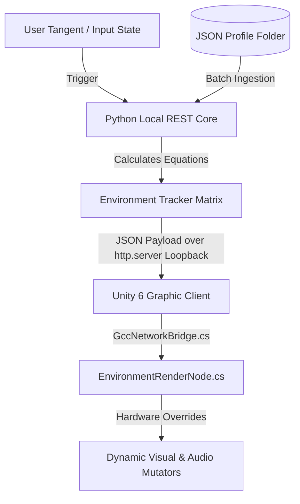

# Generative Cinematic Continuity (GCC)

The next generation of gaming technology enhanced motion picture experiences. This repository serves as the definitive open-source reference implementation for running high-fidelity dynamic narrative transformations, multi-variable character profiling, and real-time environmental state matrix synchronization pipelines.

---

## Project Workspace Directory Matrix

To ensure absolute execution and compiler integrity out of the box, organize your files locally using this exact folder pattern:

```text
GenerativeCinematicContinuity/
├── README.md
├── gcc_narrative_engine.py
├── docs/
│   └── formula_guide.md
├── profiles/
│   ├── officer_miller.json
│   └── companion_hudson.json
└── unity_project/
    └── Assets/
        └── Scripts/
            ├── EnvironmentRenderNode.cs
            └── GccNetworkBridge.cs
```

---

## Architecture Blueprint

The platform splits the runtime workload into two decoupled operational execution tracks optimized to achieve zero-lag simulation feedback loops on modest local hardware configurations (such as standard consumer laptops).



### Track A: The Python Logic Core
- **Batch Verification Loop**: Automatically scans the local `./profiles` directory path, parsed text configurations, handles data validation checks, and hooks multiple data entities into active system registers.
- **Advanced Environment Tracking**: Translates complex, non-linear character matrix changes into an explicit JSON parameter ledger tracking real-time rendering changes (`render_parameters`).
- **Zero-Dependency Streaming Node**: Deploys Python's built-in `http.server` module to expose a high-performance local REST loop loopback (`localhost:8000`), completely bypassing the overhead of heavy third-party web frameworks.

### Track B: The Unity 6 Graphic Layer
- **`GccNetworkBridge.cs`**: Performs efficient asynchronous pulling loops targeting the local Python daemon. It grabs incoming tracking matrix updates without halting the main rendering frame loops.
- **`EnvironmentRenderNode.cs`**: Parses incoming array elements and maps parameters directly to real-time hardware overrides—modulating lighting vectors, interpolating custom look-up textures (LUTs), recalculating global exponential fog visibility, and shifting audio lowpass filters dynamically on a frame-by-frame basis.

---

## Production Blueprint Files

### 1. The Character Matrix Schema (`profiles/character_profile_schema.json`)
Writers and narrative directors can add custom cast members without touching a line of code. The profile structure maps out character constraints cleanly:

```json
{
  "character_id": "psycho_town_miller",
  "biographical_data": {
    "name": "Officer Miller",
    "assigned_role": "protagonist",
    "core_flaw": "Paranoia"
  },
  "initial_narrative_state": {
    "starting_stability_index": 0.65,
    "want_vector": "Expose the town conspiracy",
    "need_vector": "Accept personal loss"
  },
  "custom_formula_weights": {
    "trauma_multiplier": 1.8,
    "redemption_multiplier": 0.5
  }
}
```

### 2. Core Creative Equations (`docs/formula_guide.md`)
The underlying state machine relies on deterministic mathematical constraints to preserve continuity during user tangents:

*   **The Big Arc Formula**: 
    \[\text{Stability}_{\text{Next}} = \text{Stability}_{\text{Current}} - (\text{Trauma} \times \text{trauma\_multiplier}) + (\text{Redemption} \times \text{redemption\_multiplier})\]
    *Tweak the multipliers inside the character profiles to design fragile psychological states or resilient character arcs.*
*   **The Three-Act Progression Formula**: Global scene values and lighting environments scale automatically relative to user choice severity thresholds:
    *   **Act I → Act II Boundary**: Breach threshold occurs at `0.4` tension (Triggers Inciting Incident).
    *   **Act II → Act III Boundary**: Breach threshold occurs at `0.8` tension (Locks in the final Climax environment).

---

## Onboarding Execution Steps (Local Laptop Deployment)

Follow these directions to deploy and experience a live local proof-of-technology simulation run:

### Step 1: Initialize Character Profiles
Create a folder titled `profiles` directly alongside `gcc_narrative_engine.py` and populate it with custom text records using the example schema configuration shown in the documentation section above.

### Step 2: Spin Up the Live Automation Network Pipeline
Execute the master orchestration server engine within your host system console workspace:
```bash
python gcc_narrative_engine.py
```
*The engine will instantly scan directories, validate your profile configurations, and spin up an active local loopback endpoint mapping environment data blocks directly onto memory structures at `http://localhost:8000/blueprint`.*

### Step 3: Configure Scene Links in Unity 6
1. Drop both `EnvironmentRenderNode.cs` and `GccNetworkBridge.cs` directly into your active Project Assets folder hierarchy.
2. Attach a standard **Directional Light** and an ambient **Audio Source** node inside your scene tree.
3. Attach an **Audio Low Pass Filter** component directly to that ambient Audio Source GameObject.
4. Attach both downloaded script assets to a persistent Master Scene Orchestration Node in your Hierarchy.
5. Drag your directional light and audio filter nodes directly into the open inspector configuration slot fields on the `EnvironmentRenderNode` script.
6. Hit **Play** inside Unity 6. The client network layer will instantly begin polling the Python core on a 1-second interval, pulling down narrative metadata updates and adjusting your scene atmospheric variables in real-time.

---

## License
Distributed under the terms of the MIT License. See `LICENSE` for details.
